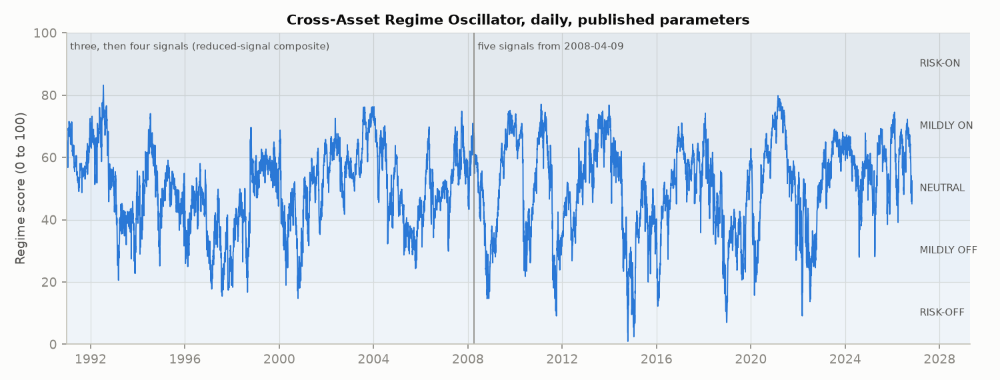
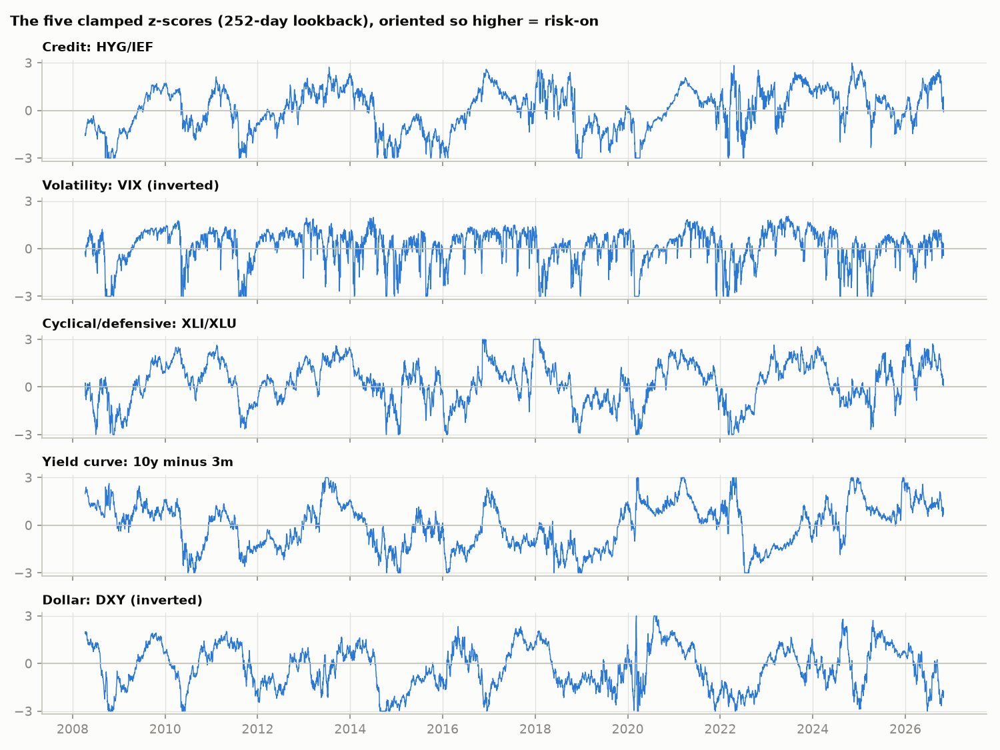
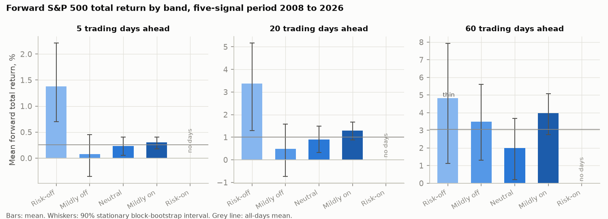
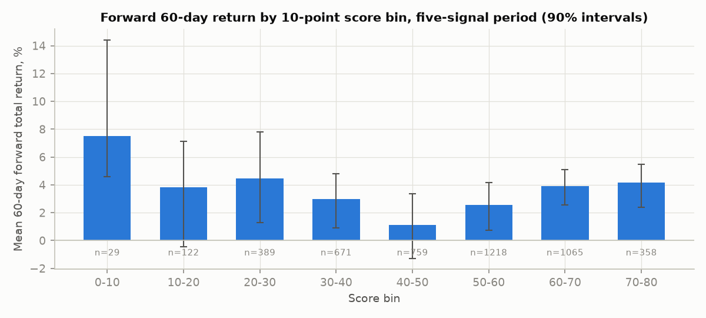
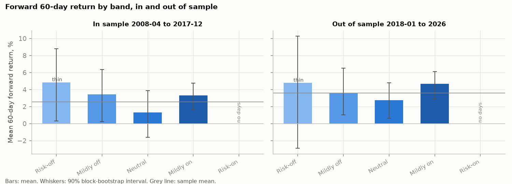
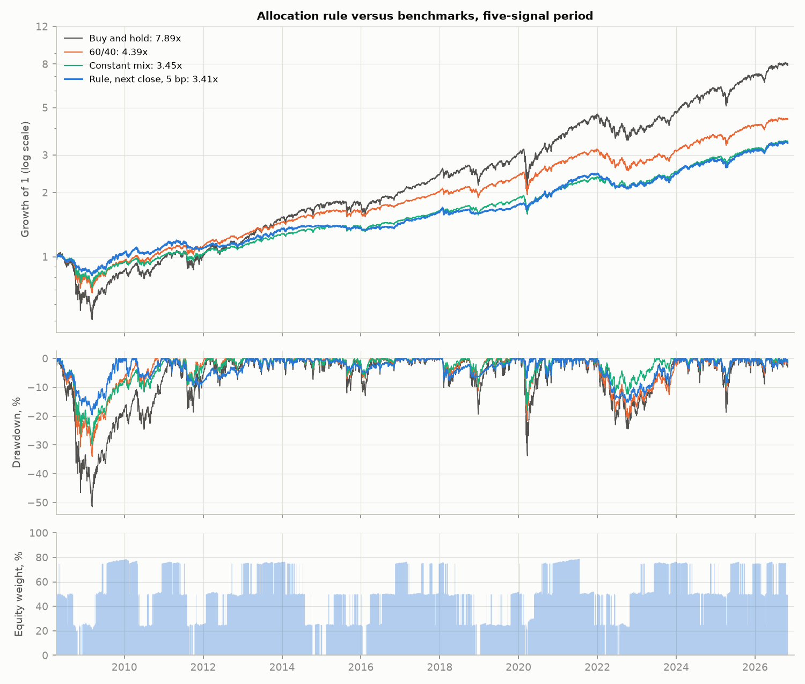
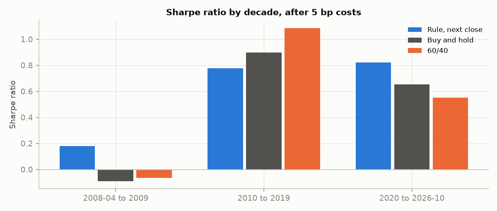
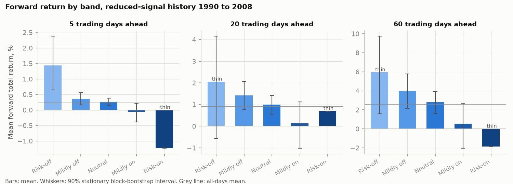

# Results: the public Cross-Asset Regime Oscillator as an S&P 500 allocation signal

Run 2026-11-01 from the frozen `analysis.py` under `PREREG.md` (commit c52091e). Data through 2026-10-30.
Every number below depends on the Python port matching the TradingView indicator; see `VERIFY.md`.
**Status: verified against TradingView on 2026-11-01** (VERIFY.md: 9 of 10 dates within 1.0 point, one at 1.13 attributed to the yield vendor; no band differs).

## Verdict

**The edge is not established.** By the pre-registered rule the outcome is the tier called "suggestive":
no hypothesis passed, but the allocation rule's Sharpe ratio sits above buy and hold in both halves of the
sample. In plain language:

- The rule (equity weight 100/75/50/25/0 by band, rest in T-bills, traded at the next close, 5 bp a side)
  returned 6.85% a year against 11.79% for buy and hold, with less than half the volatility and a maximum
  drawdown of 19.6% against 51.5%. Its Sharpe ratio is 0.69 against 0.59 for buy and hold and 0.59 for a
  constant mix with the same average equity weight. That gap of about 0.10 has a 90% bootstrap interval of
  -0.11 to +0.26: it is inside the noise.
- The Sharpe gain comes from two episodes, 2008-09 and 2020-22. In the 2010s the rule lagged buy and hold,
  the 60/40 and its own exposure-matched constant mix. On the reduced-signal history from 1991 to 2008 the
  rule's Sharpe is 0.25 below buy and hold with an interval that excludes zero, and the band ordering is
  inverted (the risk-on band had the worst forward returns).
- The strongest statistical pattern is the opposite of what the weight map assumes: days in the RISK-OFF band
  (score below 20) precede the best returns of any band at every horizon (20-day mean 3.37%, interval 1.29 to
  5.17, against 1.01% for all days). The rule holds zero equity on exactly those days. The RISK-ON band
  (score 80 or more) never occurs in the five-signal period, so the rule never holds more than 75% equity.
- The "dead zone" in MILDLY OFF shows as a point estimate at 5 and 20 days (the band's mean is the lowest of
  the four occupied bands at both horizons) but not at the pre-registered 60-day horizon, where NEUTRAL is the
  weakest band. Neither dip clears its interval. On the continuous score, the weakest 60-day forward returns
  sit in the 40 to 50 bin, not the 20 to 40 band.

What the indicator does do, reliably, is describe conditions: low readings coincide with high volatility and
wide credit spreads, and the rule's lower exposure in those conditions cuts drawdowns. That is a volatility
scaling effect and a constant mix with the same average weight captures most of it. The remaining timing
value is positive on point estimates in every split of the 2008 to 2026 sample except the 2010s, and negative
before 2008. That is not enough to call it real.

## Pre-registered hypotheses

| Hypothesis | Statistic | Result | Verdict |
|---|---|---|---|
| H1 band ordering | upper two bands minus lower two bands, mean forward return | h=20: +0.44% [-0.64, +1.66]; h=60: +0.31% [-2.04, +2.71]; OOS points +0.26% and +0.99% | **Null** |
| H2 dead zone at 60 days | D = mean NEUTRAL minus mean MILDLY OFF (RISK-OFF is THIN at h=60, 9 windows) | D = -1.48% [-3.53, +0.60]: MILDLY OFF is above NEUTRAL | **No dip** |
| H3 allocation edge | Sharpe(rule B, 5 bp) minus Sharpe(buy and hold) | +0.098 [-0.114, +0.263]; IS +0.107; OOS +0.075 [-0.217, +0.343] | **Null** |
| Overall | per section 4 of PREREG.md | H3 null with positive point estimates in both halves | **Suggestive** |

Execution A (same close, slightly optimistic) does not change any verdict: Sharpe difference +0.135 [-0.062, +0.285].

## 1. The oscillator in the data

Five-signal period 2008-04-09 to 2026-10-30, 4,671 trading days. Score quantiles: 1st 12.3, median 53.1,
99th 75.5, maximum 79.8 (2021-02-24), minimum 0.9 (2014-10-14). The composite's standard deviation is 0.91, so
a reading of 80 (composite +1.8) is a two-sigma event that never happened; the z-scores are positively
correlated (0.05 to 0.70 pairwise) but clamping at 3 and averaging five of them compresses the range.

| Band | Days | Share % | Episodes | Mean episode length (days) |
|---|---|---|---|---|
| RISK-OFF | 153 | 3.3 | 22 | 7.0 |
| MILDLY OFF | 1,058 | 22.7 | 95 | 11.1 |
| NEUTRAL | 1,993 | 42.7 | 167 | 11.9 |
| MILDLY ON | 1,467 | 31.4 | 93 | 15.8 |
| RISK-ON | 0 | 0.0 | 0 | |

376 band changes in 18.5 years (20 a year). The rule's one-way turnover is 5.0 times a year.

## 2. Forward S&P 500 total returns by band (primary sample, signal at close t, window t to t+h)

All intervals are 90% stationary block bootstrap (expected block 63 days, 5,000 resamples). "Windows" are
non-overlapping windows on the band's own dates. THIN = fewer than 10 windows, no verdict.

**5 days** (all days 0.26%)

| Band | Days | Windows | Mean % | 90% CI | Median % | Win % |
|---|---|---|---|---|---|---|
| RISK-OFF | 153 | 40 | 1.38 | [0.70, 2.21] | 1.37 | 64.7 |
| MILDLY OFF | 1058 | 245 | 0.08 | [-0.35, 0.45] | 0.55 | 58.8 |
| NEUTRAL | 1988 | 463 | 0.23 | [0.06, 0.40] | 0.35 | 59.7 |
| MILDLY ON | 1467 | 323 | 0.30 | [0.18, 0.41] | 0.43 | 61.6 |
| RISK-ON | 0 | 0 | | | | |

**20 days** (all days 1.01%)

| Band | Days | Windows | Mean % | 90% CI | Median % | Win % |
|---|---|---|---|---|---|---|
| RISK-OFF | 153 | 14 | 3.37 | [1.29, 5.17] | 4.41 | 79.7 |
| MILDLY OFF | 1058 | 76 | 0.48 | [-0.74, 1.59] | 1.52 | 61.8 |
| NEUTRAL | 1977 | 143 | 0.90 | [0.32, 1.49] | 1.47 | 66.6 |
| MILDLY ON | 1463 | 97 | 1.29 | [0.88, 1.68] | 1.75 | 71.8 |
| RISK-ON | 0 | 0 | | | | |

**60 days** (all days 3.04%)

| Band | Days | Windows | Mean % | 90% CI | Median % | Win % |
|---|---|---|---|---|---|---|
| RISK-OFF | 153 | 9 THIN | 4.83 | [1.13, 7.93] | 4.94 | 75.8 |
| MILDLY OFF | 1058 | 33 | 3.49 | [1.31, 5.60] | 3.72 | 74.0 |
| NEUTRAL | 1977 | 60 | 2.01 | [0.20, 3.67] | 3.70 | 69.6 |
| MILDLY ON | 1423 | 40 | 3.97 | [2.74, 5.07] | 4.57 | 83.2 |
| RISK-ON | 0 | 0 | | | | |

Reading: the pattern is a U, not a ladder. RISK-OFF (rare, 22 short episodes) is the best band at every
horizon; MILDLY ON is second; MILDLY OFF and NEUTRAL are below the all-days mean at 5 and 20 days. Starting
the window one day later (acting on the plotted TradingView value at the next close) changes nothing material
(section 1b of `results/tables.md`).

The RISK-OFF result is not uniform in time. The three RISK-OFF episodes of late 2008 preceded further losses
(60-day returns -13.7%, -3.6%, -9.2% from their first day). Every RISK-OFF episode from 2011 to 2019 (13 of
them) preceded a gain over 60 days. Of the two in 2020, the late-February print preceded the crash (-8.9%) and
the two-day print on 2020-03-18 and 19 marked the COVID low (+27.5%). The four episodes of 2022 preceded losses
again. So "RISK-OFF is bullish" is mostly a 2011 to 2019 statement, and the band's 22 episodes are too few to
separate the regimes.

### Dead zone (H2) at every horizon

| h | D vs min(RISK-OFF, NEUTRAL) | 90% CI | D vs NEUTRAL | 90% CI | D on medians | 90% CI |
|---|---|---|---|---|---|---|
| 5 | +0.16% | [-0.26, +0.62] | +0.16% | [-0.26, +0.62] | -0.20% | [-0.42, +0.10] |
| 20 | +0.42% | [-0.72, +1.60] | +0.42% | [-0.67, +1.67] | -0.05% | [-0.93, +0.94] |
| 60 | -1.48% | [-3.63, +0.34] | -1.48% | [-3.53, +0.60] | -0.02% | [-3.80, +1.13] |

At 5 and 20 days the MILDLY OFF mean is the lowest of the four occupied bands, which is the dead-zone shape,
but the intervals include zero and the medians do not show it. At 60 days it is gone. By the pre-registered
60-day headline: no dip.

### Continuous score, 60-day forward return by 10-point bin

| Bin | Days | Mean % | 90% CI | Median % | Win % |
|---|---|---|---|---|---|
| 0-10 | 29 | 7.51 | [4.59, 14.41] | 6.06 | 96.6 |
| 10-20 | 122 | 3.81 | [-0.44, 7.11] | 4.74 | 70.5 |
| 20-30 | 389 | 4.48 | [1.30, 7.78] | 4.36 | 76.6 |
| 30-40 | 671 | 2.99 | [0.89, 4.82] | 3.41 | 72.6 |
| 40-50 | 759 | 1.12 | [-1.27, 3.35] | 2.33 | 60.9 |
| 50-60 | 1218 | 2.56 | [0.75, 4.18] | 4.03 | 75.0 |
| 60-70 | 1065 | 3.90 | [2.56, 5.11] | 4.51 | 82.2 |
| 70-80 | 358 | 4.15 | [2.41, 5.48] | 4.70 | 86.3 |

The low point of the U is the 40 to 50 bin, inside NEUTRAL. The 0 to 10 bin is the top but it holds 29 days
from five episodes (2011, 2014, 2015, 2018 and 2022), too few to lean on.

## 3. In sample and out of sample (60 days)

| Band | IS mean % | IS 90% CI | IS windows | OOS mean % | OOS 90% CI | OOS windows |
|---|---|---|---|---|---|---|
| RISK-OFF | 4.84 | [0.33, 8.80] | 5 THIN | 4.79 | [-2.90, 10.28] | 4 THIN |
| MILDLY OFF | 3.43 | [0.22, 6.37] | 17 | 3.56 | [1.03, 6.50] | 16 |
| NEUTRAL | 1.30 | [-1.60, 3.87] | 32 | 2.75 | [0.64, 4.78] | 28 |
| MILDLY ON | 3.31 | [1.63, 4.76] | 21 | 4.67 | [2.89, 6.10] | 20 |
| all days | 2.57 | | | 3.58 | | |

The U shape repeats in both halves. H1's difference is -0.34% in sample and +0.99% out of sample at 60 days,
both inside wide intervals. Full 5- and 20-day tables for both halves are in `results/tables.md` sections 1c
and 1d.

## 4. The allocation rule

Primary sample, 5 bp per side on the traded equity amount. Rule B is the headline (trade at the next close on
the value the chart shows that day). Constant mix uses the rule's realised mean weight, 0.51.

| Strategy | CAGR % | Vol % | Sharpe | Sortino | Max DD % | Worst year % | Turnover /yr | Mean eq. weight | Days in market % |
|---|---|---|---|---|---|---|---|---|---|
| Rule, same close (A) | 7.12 | 7.9 | 0.73 | 1.01 | -19.0 | -11.4 (2008) | 5.05 | 0.51 | 97 |
| Rule, next close (B) | 6.85 | 8.0 | 0.69 | 0.96 | -19.6 | -12.5 (2008) | 5.04 | 0.51 | 97 |
| Buy and hold | 11.79 | 19.7 | 0.59 | 0.83 | -51.5 | -32.6 (2008) | | 1.00 | 100 |
| 60/40 monthly | 8.31 | 11.5 | 0.63 | 0.88 | -34.1 | -19.6 (2008) | 0.10 | | |
| Constant mix 51/49 | 6.91 | 9.8 | 0.59 | 0.81 | -29.9 | -17.3 (2008) | 0.11 | 0.51 | 100 |

**Sharpe differences (paired block bootstrap, 90%)**

| Sample | Rule B minus buy and hold | minus 60/40 | minus constant mix |
|---|---|---|---|
| Primary | +0.098 [-0.114, +0.263] | +0.061 [-0.151, +0.230] | +0.106 [-0.104, +0.274] |
| In sample | +0.107 [-0.170, +0.294] | -0.020 [-0.348, +0.195] | +0.118 [-0.158, +0.310] |
| Out of sample | +0.075 [-0.217, +0.343] | +0.140 [-0.133, +0.379] | +0.079 [-0.219, +0.352] |

**Out of sample (2018-01-02 to 2026-10-30)**

| Strategy | CAGR % | Vol % | Sharpe | Max DD % | Worst year % |
|---|---|---|---|---|---|
| Rule B | 8.90 | 8.4 | 0.74 | -15.2 | -12.4 (2022) |
| Buy and hold | 14.37 | 19.1 | 0.66 | -33.8 | -18.1 (2022) |
| 60/40 | 9.26 | 11.5 | 0.59 | -21.6 | -15.9 (2022) |
| Constant mix | 8.86 | 9.6 | 0.66 | -18.1 | -8.2 (2022) |

Note the 2022 line: the rule lost 12.4% while the constant mix with the same average exposure lost 8.2%. The
rule was lightest in the two bear-market rallies (mean weight 0.25 during the +11% rally of March 2022 and 0.19
during the +18% rally of June to August) and heavier in the declines around them (0.36 to 0.39). Its timing
inside 2022 was the wrong way round.

**Calendar years** (rule B against buy and hold): the rule beat buy and hold in 2008 (-12.5 vs -32.6), 2018
(-0.9 vs -4.4), 2020 (19.2 vs 18.4) and 2022 (-12.4 vs -18.1), and lagged in every other year, usually by
half the market's gain. Full table in `results/tables.md` section 10.

## 5. Robustness

**By decade (Sharpe, rule B / buy and hold / 60/40 / constant mix):**

| Period | Rule B | Buy and hold | 60/40 | Constant mix | Rule B CAGR % | B&H CAGR % |
|---|---|---|---|---|---|---|
| 2008-04 to 2009 | 0.18 | -0.09 | -0.07 | -0.15 | 2.03 | -8.82 |
| 2010 to 2019 | 0.78 | 0.90 | 1.09 | 0.90 | 5.41 | 13.58 |
| 2020 to 2026-10 | 0.82 | 0.65 | 0.55 | 0.65 | 10.29 | 15.03 |

The rule wins the two crisis-containing periods and loses the calm decade, to every benchmark including the
exposure-matched one. A rule that de-risks on stress will always look like this in a sample with two major
drawdowns; the question is whether the de-risking is timely, and the 2010s say it is not better than static.

**Execution delay:** Execution A (same close) to B (next close) costs 0.27% a year of CAGR and 0.04 of Sharpe.
Nothing turns on the delay, which also means the signal is slow enough to trade on the published chart value.

**Costs:** rule B CAGR / Sharpe at 0, 5, 10, 20 bp per side: 7.12 / 0.72, 6.85 / 0.69, 6.58 / 0.66, 6.04 / 0.60.
At 20 bp the Sharpe advantage over buy and hold is essentially gone (0.60 vs 0.59).

**Extended reduced-signal history, 1990-12-28 to 2008-04-08** (three signals, then four from 1999-12; this
is what the published script computes on a chart that reaches back that far):

| Band | Days | 60-day mean % | 90% CI |
|---|---|---|---|
| RISK-OFF | 48 | 5.94 | [1.60, 9.76] (THIN) |
| MILDLY OFF | 923 | 3.99 | [2.17, 5.77] |
| NEUTRAL | 2444 | 2.80 | [1.62, 3.92] |
| MILDLY ON | 936 | 0.53 | [-2.04, 2.71] |
| RISK-ON | 3 | -1.85 | (THIN) |

H1 on this history is **contrary** at every horizon (60-day difference -3.56% [-6.73, -0.73]). The rule's Sharpe
is 0.23 against 0.48 for buy and hold, difference -0.247 [-0.383, -0.101]; CAGR 5.57% against 10.82%, with a
31% drawdown in 2000-02 against 24% for the constant mix. In the 1990s and 2000s the oscillator, as published,
was a contrarian indicator and the rule a losing one.

## 6. Where it fails, in one list

1. The top band never happens. A 0 to 100 scale whose top fifth is unreachable means the rule's "100%" step is
   decorative and its average exposure is 51%.
2. The bottom band is a buy signal on average, not a sell signal, in 2011 to 2020. The weight map has it at
   zero. In 2008 and 2022 it was correctly a sell signal. Both facts come from 22 episodes.
3. The middle is flat. MILDLY OFF, NEUTRAL and MILDLY ON differ by at most 2 percentage points over 60 days
   with overlapping intervals.
4. The calm decade is a loss. 2010 to 2019: Sharpe 0.78 vs 0.90 for a static 51/49 mix.
5. Before 2008 the whole relationship inverts.
6. Twenty band changes a year, five units of one-way turnover, and a signal that needs the VIX and the dollar
   index closes after the equity close. At 20 bp per side the risk-adjusted advantage is gone.

## 7. Changes after pre-registration

- `analysis.py` commit c52091e was run unchanged for every number above. One later edit set matplotlib's
  `axes.axisbelow` so gridlines draw behind bars; it touches no computation and the re-run reproduced every
  number and verdict (same seed).

## 8. Files

- `results/tables.md`: every table, including all horizons for every sample and the full decade tables.
- `results/band_tables.csv`, `h1_h2.csv`, `score_bins.csv`, `metrics.csv`, `h3_sharpe.csv`,
  `cost_sensitivity.csv`, `calendar_years.csv`, `daily_returns_primary_5bp.csv`, `held_weights_primary.csv`,
  `verdicts.json`.
- `paper/figures/fig1` to `fig8`.
