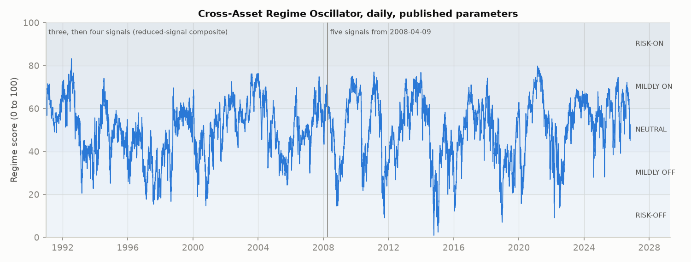
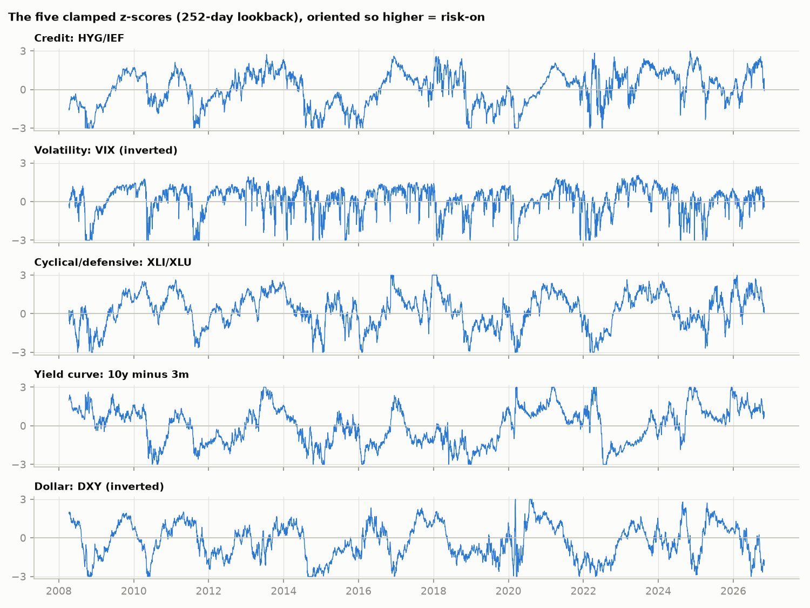
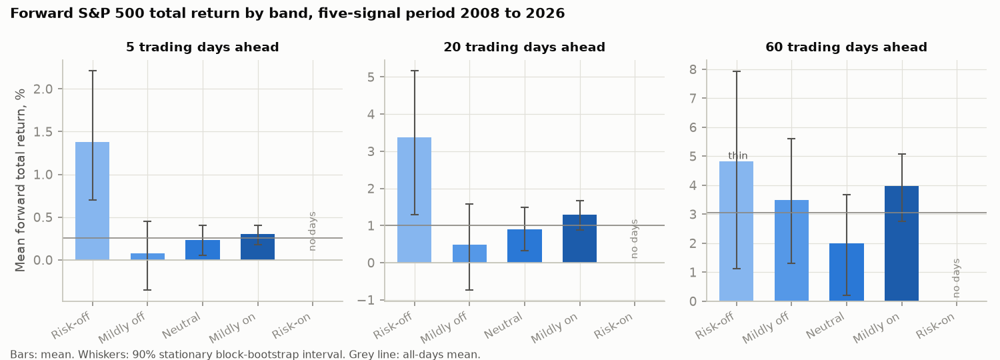
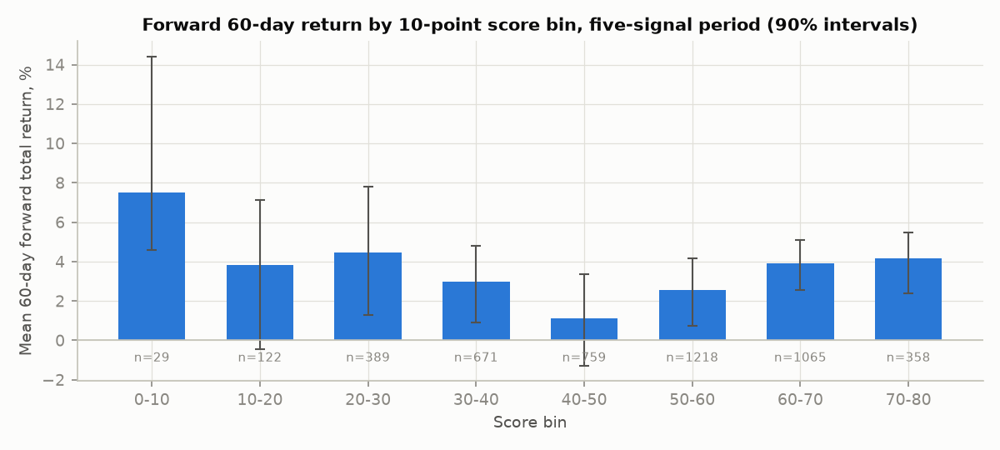
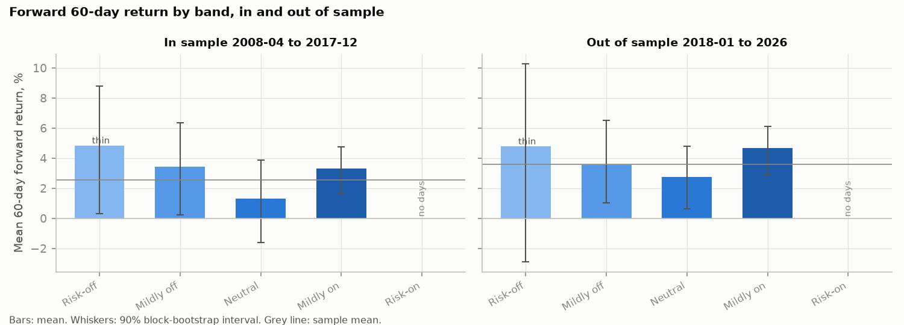
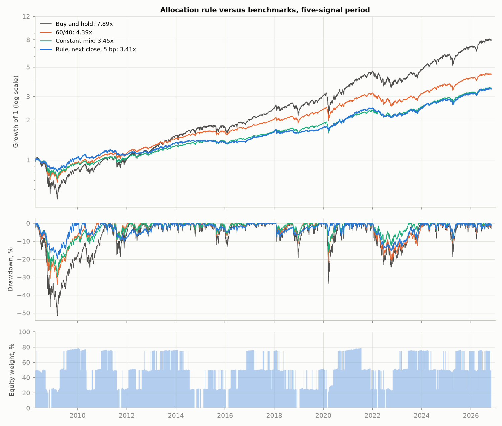
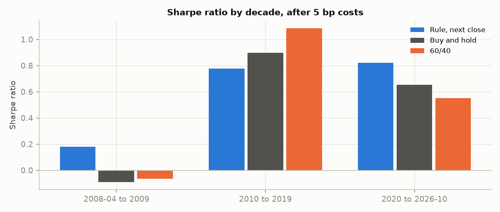
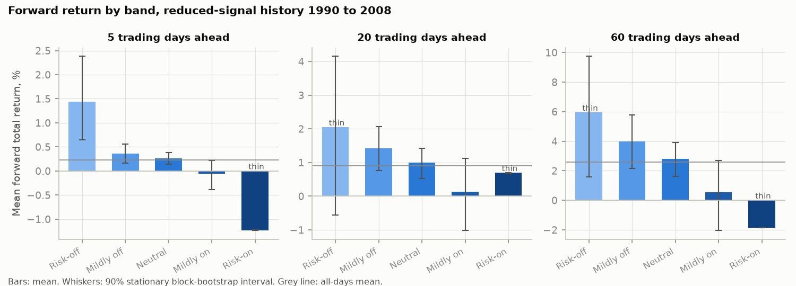

# Does a Transparent Cross-Asset Regime Oscillator Time the S&P 500? A Pre-Registered Test of a Public TradingView Indicator

Ryan Brooks (the author also publishes regimecard.com)

This paper tests the author's open-source TradingView indicator. It makes no claim about the indicator
published at regimecard.com, which is a different construction and is not studied here.

Working paper, November 2026. Prepared for the Quantpedia Awards 2027.

## Abstract

We test whether a simple, fully public market-regime gauge carries information about forward S&P 500 returns
and whether a mechanical allocation rule built on it beats passive benchmarks after costs. The gauge is the
open-source Cross-Asset Regime Oscillator published on TradingView: five daily cross-asset signals (high-yield
versus Treasury ETF ratio, VIX, industrials versus utilities ETF ratio, the 10-year minus 3-month Treasury
slope, and the ICE dollar index), each z-scored over 252 trading days, clamped to plus or minus 3, averaged
with equal weight and mapped to a 0 to 100 score with five bands. We rebuild it from free data, pre-register
hypotheses, horizons, statistics and one allocation rule before computing any forward return, and evaluate
2008 to 2026 with a chronological in-sample and out-of-sample split, stationary block-bootstrap intervals and
a reduced-signal check back to 1991. The port is verified against the chart on ten dates. A rule holding
100/75/50/25/0 percent equity by band, traded at the next close with 5 basis points per side, cuts the maximum
drawdown from 52% to 20% at a risk-adjusted return that is not distinguishable from buy and hold or from a
constant mix with the same average exposure: a Sharpe ratio of 0.69 against 0.59 for both, a gap with a 90%
interval of -0.11 to +0.26. About two thirds of the drawdown reduction is the exposure the rule removes, which
a static half-exposure also removes; the remaining third and the whole of the Sharpe gap come from de-risking
inside the 2008 and 2020 to 2022 episodes, are absent in the 2010s and reverse before 2008. Forward returns
by band form a U rather than a ladder: the rare RISK-OFF band (3% of days) precedes the highest returns at
every horizon, the middle three bands are statistically indistinguishable, and the RISK-ON band never
occurs. We conclude that the oscillator describes conditions and reduces drawdown, and that a timing edge
beyond exposure is not established. All code, data sources and the pre-registration are provided so that
every step can be reproduced.

## 1. Introduction

Market-regime indicators that combine credit, volatility, equity leadership, the yield curve and the dollar
are common in practitioner research and on charting platforms. Most are proprietary, and the published
backtests that accompany them rarely separate three things: whether the indicator describes current
conditions, whether it forecasts returns, and whether a rule built on it beats a passive mix of equities and
cash with the same average exposure. This paper takes one such indicator that is entirely public, the
Cross-Asset Regime Oscillator on TradingView (regimecard, 2026), and tests it under conditions chosen to make
a favourable result hard to manufacture: the published parameters only, hypotheses and the allocation rule
fixed and committed before any forward return was computed, overlapping-window dependence handled with a
block bootstrap, a chronological out-of-sample half, costs, an execution delay, and a reduced-signal history
back to 1991 that the indicator itself would compute on a long chart.

The indicator is attractive as a research object because it is simple enough to be rebuilt line for line
from free data and because its construction is typical of the genre: equal weights, one lookback, z-scores,
a clamp, and fixed bands. If this construction carries a timing edge, it should show on the index it is meant
to describe, the S&P 500. If it does not, the result is informative about the genre, not only about this
script.

Three questions are asked. First, do forward S&P 500 total returns differ by band, and in the direction the
labels imply? Second, does the second-lowest band, MILDLY OFF, show the "dead zone" pattern sometimes
reported for mid-low readings of regime gauges, in which the band between outright stress and neutral has
the worst forward returns? Third, does a fully specified allocation rule, checked at every close and executed
at the same or the next close, beat buy and hold, a 60/40 portfolio and an exposure-matched constant mix after
5 basis points per side?

Our contribution is methodological as much as empirical. The pre-registration (Appendix A and the
repository file PREREG.md) was committed before the analysis ran. The verification protocol (Appendix B)
makes the port falsifiable against the chart, and it was carried out: on ten dates from 2011 to 2026 the
port's plotted value is within 0.7 points of the chart on nine and 1.1 points on one, with the difference
traced to the yield and dollar inputs, which TradingView takes from a different vendor. Every table is
produced by one frozen script from files whose sources and start dates are documented. There are no black
boxes.

## 2. The indicator

The Cross-Asset Regime Oscillator is a Pine Script v6 indicator published under the regimecard account on
TradingView. Its full specification, reproduced from the source, is in Appendix A. In brief:

1. Five daily series: credit (HYG divided by IEF), equity volatility (VIX, inverted), cyclical versus defensive
   equities (XLI divided by XLU), the yield-curve slope (US 10-year yield minus US 3-month yield) and the US
   dollar (ICE dollar index DXY, inverted).
2. Each series is z-scored against its own trailing 252 daily bars: (x minus simple moving average) divided by
   the population standard deviation. The z-score is clamped to the range -3 to +3. A series is "not available"
   until 252 bars exist or when its standard deviation is zero.
3. The composite is the equal-weight mean of the available z-scores (VIX and DXY enter with their sign
   flipped). A signal that is not available is skipped and the mean is taken over the rest.
4. The score is 50 plus the composite times 100/6, clamped to 0 to 100. Bands: 0 to 20 RISK-OFF, 20 to 40
   MILDLY OFF, 40 to 60 NEUTRAL, 60 to 80 MILDLY ON, 80 to 100 RISK-ON.
5. The plotted value on a chart bar is computed from each input's previous confirmed daily bar (the script
   requests the one-bar-lagged z-score inside the daily security context), so the chart never repaints and
   the value shown during a session is the prior session's.

The score is bounded in practice far inside 0 to 100. With five positively but imperfectly correlated
z-scores (pairwise correlations between 0.05 and 0.70 in our data) each clamped at 3, the composite's standard
deviation is 0.91 and a score of 80 requires a composite of +1.8. In 4,671 days with all five signals the
maximum score was 79.8 (2021-02-24) and the minimum 0.9 (2014-10-14). The RISK-ON band therefore has zero days
in the main sample, a structural fact known before any return was computed and recorded in the
pre-registration.

## 3. Data

All inputs are free and documented in the repository file data/SOURCES.md with first and last dates, row
counts and file hashes. Table 1 summarises them.

**Table 1. Data sources.**

| Series | Role | Source | First date |
|---|---|---|---|
| HYG, IEF | credit ratio | Yahoo Finance, unadjusted close | 2007-04-11 (HYG), 2002-07-30 (IEF) |
| XLI, XLU | cyclical/defensive ratio | Yahoo Finance, unadjusted close | 1998-12-22 |
| VIX | volatility | Yahoo Finance (CBOE close); FRED VIXCLS as cross-check | 1990-01-02 |
| DGS10, DGS3MO | yield-curve slope | FRED, H.15 constant maturity, percent | 1962-01-02, 1981-09-01 |
| DX-Y.NYB | dollar index | Yahoo Finance (ICE) | 1971-01-04 |
| S&P 500 Total Return (^SP500TR) | forward returns, equity leg | Yahoo Finance | 1988-01-04 |
| DTB3 | T-bill return and risk-free rate | FRED, 3-month bill discount yield | 1954-01-04 |
| VBMFX | bond leg of the 60/40 | Yahoo Finance, adjusted close | 1986-12-11 |
| ^GSPC | US equity trading calendar | Yahoo Finance | 1960-01-04 |

Yahoo's unadjusted close matches what TradingView plots by default for the ETF ratios: split-adjusted but not
dividend-adjusted. None of HYG, IEF, XLI or XLU has split, so the point is moot for them. FRED's constant
maturity yields are the closest free equivalent of TradingView's TVC:US10Y and TVC:US03MY, which come from a
different vendor with a different fixing time; Appendix B shows that this is where the residual differences
between the port and the chart lie. Yahoo's VIX and FRED's VIXCLS disagree by more than 0.05 on 9
of 9,274 common days; we use Yahoo.

Each signal is z-scored on its own daily calendar, as the script does, then aligned to the US equity trading
calendar by taking the latest bar on or before each equity trading day. FRED prints no yield on bond-market
holidays, so the curve signal skips those days exactly as a missing TradingView bar would be skipped.

The five-signal period begins 2008-04-09 (HYG's first bar plus 252) and runs to 2026-10-30: 4,671 trading
days. Before that the script's missing-data rule produces a composite of four signals from 1999-12-21 and three
from 1990-12-28. We treat the five-signal period as the primary sample and the reduced-signal period as a
robustness check, clearly labelled, since the two composites are different instruments.

## 4. Method

### 4.1 Pre-registration

The repository file PREREG.md, committed before analysis.py was run on real data, fixes the samples, the
horizons, the statistics, the hypotheses and their pass rules, the allocation rule and its benchmarks, and the
verdict tiers. The analysis script was frozen in the same commit after a smoke test on synthetic random-walk
prices. The only edit after the run was a cosmetic plotting flag; the re-run reproduced every number. No
parameter of the indicator was varied. Section 5 of PREREG.md lists every "look" taken so that the reader can
judge multiplicity: three horizons, two window timings, four samples, three decades, two executions, four cost
levels and three benchmarks, of which only three statistics carry verdicts.

### 4.2 Timing

Two timings are produced for every equity trading day t. The signal value uses closes through t for every
input that traded on t; it is the information set at the close of t, with the caveat that the VIX settles at
16:15 ET and the dollar index at about 17:00 ET. The plotted TradingView value on bar t is the signal value of
the previous confirmed bar of each input. An investor who acts at the close on the value the chart shows that
day is therefore acting on the previous day's signal. We call executing on the signal at the close of t
"Execution A, same close" and executing at the close of t+1 "Execution B, next close". Execution B is the
headline because it is exactly what the chart permits.

### 4.3 Forward returns and bootstrap

For every signal day t, the band is read from the signal value and the forward total return r_h(t) is the S&P
500 Total Return index at t+h divided by its value at t, minus one, for h = 5, 20 and 60 trading days. Per
band and horizon we report days, non-overlapping windows (a greedy count on the band's own dates), mean,
median, win rate and a 90% interval for the mean from a stationary block bootstrap (Politis and Romano, 1994)
with geometric block lengths of expected length 63 trading days, circular wrap and 5,000 resamples. Every
resample recomputes every band jointly, so differences between bands have their own intervals. A band with
fewer than 10 non-overlapping windows at a horizon is flagged thin and carries no verdict.

H1 (band ordering) is the mean forward return of the upper two bands minus that of the lower two; it is
supported if the 90% interval lies above zero at both 20 and 60 days in the primary sample and the
out-of-sample point estimate is positive. H2 (dead zone) is D, the smaller of the RISK-OFF and NEUTRAL means
minus the MILDLY OFF mean at 60 days; it is "real" if positive at the point estimate with a 5th percentile
above zero. The pre-registration specified that if RISK-OFF is thin at 60 days, NEUTRAL alone is the comparator.

### 4.4 The allocation rule

At every US equity close the band is read and the equity weight set to 100% for RISK-ON, 75% MILDLY ON, 50%
NEUTRAL, 25% MILDLY OFF and 0% RISK-OFF, with the remainder in T-bills earning the DTB3 rate. Positions drift
between band changes and are traded to target only when the band changes, paying 5 basis points of the
traded equity amount. The benchmarks are buy and hold of the total return index with no cost, a 60/40 mix of
the index and VBMFX rebalanced at month end with the same cost, and an exposure-matched constant mix whose
equity weight equals the rule's realised mean weight (0.51) rebalanced at month end with the same cost. The
constant mix is the critical comparison: mixing an asset with cash leaves its Sharpe ratio unchanged, so any
Sharpe advantage of the rule over the constant mix, or over buy and hold, is timing rather than exposure.

H3 is the Sharpe ratio of the rule (Execution B, 5 basis points) minus that of buy and hold, with a 90%
interval from the same block bootstrap applied to the paired daily returns. It is supported if the interval
lies above zero in the primary sample and the out-of-sample point estimate is positive. The overall verdict
is "edge is real" if H3 is supported together with H1 or H2, "suggestive" if H3 is null with positive point
estimates in both halves (or supported without a mechanism), and "no edge" otherwise.

Metrics: compound annual growth rate, annualised volatility, Sharpe (mean daily excess return over the
T-bill rate times 252, divided by annualised volatility), Sortino (same numerator over annualised downside
deviation of excess returns), maximum drawdown, worst calendar year, one-way turnover per year, mean equity
weight and the share of days with any equity.

### 4.5 Samples

Primary: 2008-04-09 to 2026-10-30, with forward windows truncating the usable end by h days. In sample: to
2017-12-29 (2,451 days). Out of sample: from 2018-01-02 (2,220 days). The split is chronological and fixed
in advance; the indicator was published in 2026 so there is no post-publication period of useful length.
Decades: 2008-04 to 2009, 2010 to 2019, 2020 to 2026-10. Extended reduced-signal check: 1990-12-28 to
2008-04-08 (4,354 days).

## 5. Results

### 5.1 Band occupancy

Table 2 gives the distribution of days. The oscillator spends three quarters of the time in NEUTRAL and
MILDLY ON, three percent in RISK-OFF (22 episodes averaging seven days) and never in RISK-ON. It changes band
376 times in 18.5 years.

**Table 2. Band occupancy, five-signal period.**

| Band | Days | Share % | Episodes | Mean length (days) |
|---|---|---|---|---|
| RISK-OFF | 153 | 3.3 | 22 | 7.0 |
| MILDLY OFF | 1,058 | 22.7 | 95 | 11.1 |
| NEUTRAL | 1,993 | 42.7 | 167 | 11.9 |
| MILDLY ON | 1,467 | 31.4 | 93 | 15.8 |
| RISK-ON | 0 | 0.0 | 0 | |

Figure 1 plots the score with the bands; Figure 2 the five z-scores.

### 5.2 Forward returns by band

Table 3 reports the primary-sample results. Figure 3 plots them.

**Table 3. Forward S&P 500 total return by band, primary sample, window t to t+h.**

| h | Band | Days | Windows | Mean % | 90% CI | Median % | Win % |
|---|---|---|---|---|---|---|---|
| 5 | RISK-OFF | 153 | 40 | 1.38 | [0.70, 2.21] | 1.37 | 64.7 |
| 5 | MILDLY OFF | 1058 | 245 | 0.08 | [-0.35, 0.45] | 0.55 | 58.8 |
| 5 | NEUTRAL | 1988 | 463 | 0.23 | [0.06, 0.40] | 0.35 | 59.7 |
| 5 | MILDLY ON | 1467 | 323 | 0.30 | [0.18, 0.41] | 0.43 | 61.6 |
| 5 | all days | 4666 | | 0.26 | | | |
| 20 | RISK-OFF | 153 | 14 | 3.37 | [1.29, 5.17] | 4.41 | 79.7 |
| 20 | MILDLY OFF | 1058 | 76 | 0.48 | [-0.74, 1.59] | 1.52 | 61.8 |
| 20 | NEUTRAL | 1977 | 143 | 0.90 | [0.32, 1.49] | 1.47 | 66.6 |
| 20 | MILDLY ON | 1463 | 97 | 1.29 | [0.88, 1.68] | 1.75 | 71.8 |
| 20 | all days | 4651 | | 1.01 | | | |
| 60 | RISK-OFF | 153 | 9 (thin) | 4.83 | [1.13, 7.93] | 4.94 | 75.8 |
| 60 | MILDLY OFF | 1058 | 33 | 3.49 | [1.31, 5.60] | 3.72 | 74.0 |
| 60 | NEUTRAL | 1977 | 60 | 2.01 | [0.20, 3.67] | 3.70 | 69.6 |
| 60 | MILDLY ON | 1423 | 40 | 3.97 | [2.74, 5.07] | 4.57 | 83.2 |
| 60 | all days | 4611 | | 3.04 | | | |

The shape is a U. RISK-OFF has the highest mean and median at every horizon, with intervals that exclude the
all-days mean at 5 and 20 days. MILDLY ON is second, with the tightest intervals because it is the largest
calm-period band. MILDLY OFF and NEUTRAL sit at or below the all-days mean. Starting every window one day
later, to mimic acting on the plotted chart value, changes no number by more than 0.3 percentage points.

**H1 is null.** The upper-minus-lower difference is +0.44% [-0.64, +1.66] at 20 days and +0.31% [-2.04, +2.71]
at 60 days. The out-of-sample point estimates are positive (+0.26% and +0.99%) but the full-sample intervals
include zero by a wide margin. The ordering the band labels imply does not hold even on point estimates,
because the lowest band is the best.

**H2 is "no dip".** At 60 days RISK-OFF is thin (9 windows), so the pre-registered comparator is NEUTRAL alone,
and D is -1.48% [-3.53, +0.60]: MILDLY OFF is above NEUTRAL, not below. At the shorter horizons the dead-zone
shape does appear on point estimates: MILDLY OFF has the lowest mean of the four occupied bands at both 5 and
20 days, with D of +0.16% [-0.26, +0.62] and +0.42% [-0.67, +1.67]. The medians do not show it at any horizon.
On the continuous score (Table 4, Figure 4) the trough of the U at 60 days is the 40 to 50 bin, inside
NEUTRAL.

**Table 4. Mean 60-day forward return by 10-point score bin, primary sample.**

| Bin | Days | Mean % | 90% CI | Median % | Win % |
|---|---|---|---|---|---|
| 0-10 | 29 | 7.51 | [4.59, 14.41] | 6.06 | 96.6 |
| 10-20 | 122 | 3.81 | [-0.44, 7.11] | 4.74 | 70.5 |
| 20-30 | 389 | 4.48 | [1.30, 7.78] | 4.36 | 76.6 |
| 30-40 | 671 | 2.99 | [0.89, 4.82] | 3.41 | 72.6 |
| 40-50 | 759 | 1.12 | [-1.27, 3.35] | 2.33 | 60.9 |
| 50-60 | 1218 | 2.56 | [0.75, 4.18] | 4.03 | 75.0 |
| 60-70 | 1065 | 3.90 | [2.56, 5.11] | 4.51 | 82.2 |
| 70-80 | 358 | 4.15 | [2.41, 5.48] | 4.70 | 86.3 |

The RISK-OFF result deserves a closer look because it drives the shape and rests on 22 episodes. The three
episodes of October to December 2008 preceded further losses of 14%, 4% and 9% over 60 days. The thirteen
episodes from 2011 to 2019 all preceded 60-day gains, between 1% and 11%. Of the two in 2020, the
late-February print preceded the crash and the two-day print on 2020-03-18 and 19 marked the low. The four
episodes of 2022 preceded losses of 1% to 7%. The bottom band is a buy signal in the decade of buy-the-dip
and a sell signal in the two bear markets, which is what one would expect from a composite of volatility and
credit readings: extreme readings mark either the start of a cascade or its end, and the oscillator does not
say which.

### 5.3 In sample and out of sample

Table 5 gives the 60-day results in both halves; Figure 5 plots them. The U shape repeats. In neither half
do any two occupied bands have non-overlapping 90% intervals.

**Table 5. 60-day forward return by band, in sample (to 2017-12) and out of sample (from 2018-01).**

| Band | IS mean % | IS 90% CI | IS windows | OOS mean % | OOS 90% CI | OOS windows |
|---|---|---|---|---|---|---|
| RISK-OFF | 4.84 | [0.33, 8.80] | 5 (thin) | 4.79 | [-2.90, 10.28] | 4 (thin) |
| MILDLY OFF | 3.43 | [0.22, 6.37] | 17 | 3.56 | [1.03, 6.50] | 16 |
| NEUTRAL | 1.30 | [-1.60, 3.87] | 32 | 2.75 | [0.64, 4.78] | 28 |
| MILDLY ON | 3.31 | [1.63, 4.76] | 21 | 4.67 | [2.89, 6.10] | 20 |
| all days | 2.57 | | | 3.58 | | |

### 5.4 The allocation rule

Table 6 reports the rule and its benchmarks over the primary sample; Figure 6 plots growth, drawdown and the
equity weight.

**Table 6. Allocation rule and benchmarks, 2008-04-09 to 2026-10-30, 5 basis points per side.**

| Strategy | CAGR % | Vol % | Sharpe | Sortino | Max DD % | Worst year % | Turnover /yr | Mean weight | Days in market % |
|---|---|---|---|---|---|---|---|---|---|
| Rule, same close (A) | 7.12 | 7.9 | 0.73 | 1.01 | -19.0 | -11.4 (2008) | 5.05 | 0.51 | 97 |
| Rule, next close (B) | 6.85 | 8.0 | 0.69 | 0.96 | -19.6 | -12.5 (2008) | 5.04 | 0.51 | 97 |
| Buy and hold | 11.79 | 19.7 | 0.59 | 0.83 | -51.5 | -32.6 (2008) | | 1.00 | 100 |
| 60/40 monthly | 8.31 | 11.5 | 0.63 | 0.88 | -34.1 | -19.6 (2008) | 0.10 | | |
| Constant mix 51/49 | 6.91 | 9.8 | 0.59 | 0.81 | -29.9 | -17.3 (2008) | 0.11 | 0.51 | 100 |

The rule's compound return is 4.9 percentage points a year below buy and hold and essentially equal to the
constant mix with the same average weight (6.85% against 6.91%). Its volatility is 8.0% against 9.8% for the
constant mix, so its Sharpe ratio is higher, 0.69 against 0.59, and its maximum drawdown is 19.6% against
29.9%. That is the whole case for the rule: the same return as a static half-exposure, with a fifth less
volatility and a third less drawdown.

**H3 is null.** Table 7 gives the paired Sharpe differences. Against buy and hold the rule's Sharpe advantage
is +0.098 with a 90% interval of [-0.114, +0.263]. The in-sample and out-of-sample point estimates are +0.107
and +0.075, both positive, which places the overall verdict in the pre-registered "suggestive" tier rather
than "no edge". Against the constant mix the advantage is +0.106 [-0.104, +0.274]; against the 60/40, which
benefited from the bond bull market of the in-sample half, +0.061 [-0.151, +0.230]. Execution A changes no
verdict (+0.135 [-0.062, +0.285] against buy and hold).

**Table 7. Sharpe ratio of rule B minus benchmark, paired stationary block bootstrap, 90% intervals.**

| Sample | minus buy and hold | minus 60/40 | minus constant mix |
|---|---|---|---|
| Primary | +0.098 [-0.114, +0.263] | +0.061 [-0.151, +0.230] | +0.106 [-0.104, +0.274] |
| In sample | +0.107 [-0.170, +0.294] | -0.020 [-0.348, +0.195] | +0.118 [-0.158, +0.310] |
| Out of sample | +0.075 [-0.217, +0.343] | +0.140 [-0.133, +0.379] | +0.079 [-0.219, +0.352] |

Out of sample the rule returned 8.90% a year at 8.4% volatility (Sharpe 0.74, maximum drawdown 15.2%) against
14.37% at 19.1% for buy and hold (0.66, 33.8%) and 8.86% at 9.6% for the constant mix (0.66, 18.1%). In
calendar-year terms the rule beat buy and hold in 2008, 2018, 2020 and 2022 and lagged it in every other
year, usually by about half the market's gain.

## 6. Robustness

### 6.1 By decade

**Table 8. Sharpe ratio and CAGR by decade, 5 basis points per side.**

| Period | Rule B Sharpe | Buy and hold | 60/40 | Constant mix | Rule B CAGR % | Buy and hold CAGR % |
|---|---|---|---|---|---|---|
| 2008-04 to 2009 | 0.18 | -0.09 | -0.07 | -0.15 | 2.03 | -8.82 |
| 2010 to 2019 | 0.78 | 0.90 | 1.09 | 0.90 | 5.41 | 13.58 |
| 2020 to 2026-10 | 0.82 | 0.65 | 0.55 | 0.65 | 10.29 | 15.03 |

The rule's advantage lives in the two periods that contain a crash. In the calm decade it loses to every
benchmark including the exposure-matched one, by 0.12 of Sharpe. A rule that lowers exposure when volatility
and credit spreads are high will always look good across a crash and poor across a melt-up; the question is
whether its timing inside those episodes adds anything beyond the exposure it removes, and the 2010s say no.
The year 2022 says the same in miniature: the rule was lightest (mean weight 0.19 to 0.25) during that year's
two bear-market rallies of 11% and 18%, and heavier (0.36 to 0.39) during the declines around them, and lost
12.4% against 8.2% for the constant mix.

### 6.2 Execution delay and costs

Moving execution from the same close to the next close costs 0.27 percentage points of annual return and 0.04
of Sharpe. The signal is slow enough that the delay does not matter, which is also why it can be traded from
the published chart. At 0, 5, 10 and 20 basis points per side the rule's CAGR and Sharpe are 7.12 / 0.72,
6.85 / 0.69, 6.58 / 0.66 and 6.04 / 0.60. At 20 basis points the Sharpe advantage over buy and hold is 0.01.
With 20 band changes a year and five units of one-way turnover, the rule is not cheap for what it does.

### 6.3 Reduced-signal history, 1991 to 2008

The published script, placed on a chart that reaches back to 1990, computes a composite of three signals
(volatility, curve, dollar) until December 1999 and four (adding cyclical versus defensive) until April 2008.
Table 9 and Figure 8 report forward returns by band of that composite; Table 10 the rule.

**Table 9. 60-day forward return by band, reduced-signal composite, 1990-12-28 to 2008-04-08.**

| Band | Days | Mean % | 90% CI | Windows |
|---|---|---|---|---|
| RISK-OFF | 48 | 5.94 | [1.60, 9.76] | 6 (thin) |
| MILDLY OFF | 923 | 3.99 | [2.17, 5.77] | 31 |
| NEUTRAL | 2444 | 2.80 | [1.62, 3.92] | 62 |
| MILDLY ON | 936 | 0.53 | [-2.04, 2.71] | 29 |
| RISK-ON | 3 | -1.85 | | 1 (thin) |

**Table 10. Allocation rule, reduced-signal history, 5 basis points per side.**

| Strategy | CAGR % | Vol % | Sharpe | Max DD % | Worst year % |
|---|---|---|---|---|---|
| Rule B | 5.57 | 8.1 | 0.23 | -31.1 | -19.4 (2002) |
| Buy and hold | 10.82 | 16.0 | 0.48 | -47.4 | -22.1 (2002) |
| 60/40 | 9.50 | 9.7 | 0.59 | -25.8 | -10.5 (2002) |
| Constant mix 50/50 | 7.57 | 7.9 | 0.47 | -24.2 | -10.5 (2002) |

On this history the ordering inverts: the higher the band, the lower the forward return, and H1's statistic is
-3.56% [-6.73, -0.73] at 60 days. The rule's Sharpe is 0.25 below buy and hold with an interval of [-0.38,
-0.10] that excludes zero, and its drawdown in 2000 to 2002 (31%) is deeper than the constant mix's (24%). We
do not treat this as a test of the five-signal oscillator, which did not exist, but it is what the published
indicator shows a user who scrolls back, and it is a warning that the sign of the relationship between this
family of readings and forward returns is not stable across decades.

## 7. Limitations

1. The port is a rebuild from free data, not the chart itself. On the ten verification dates it is within one
   point of the plotted value on nine and 1.1 points on one (Appendix B); the residual sits in the yield-curve
   and dollar inputs, which TradingView takes from a different vendor at a different fixing time. A one-point
   difference in the score can move a day across a band edge, so the band tables are statements about the
   port as specified in Appendix A, and a reader rebuilding the indicator from the TradingView feeds should
   expect a handful of days to change band.
2. The sample contains two bear markets and one calm decade. Every allocation result is dominated by 2008 and
   2020 to 2022; the bootstrap intervals are honest about this but cannot manufacture more crises.
3. RISK-OFF has 22 episodes and RISK-ON none. Statements about the extremes are statements about a handful of
   events.
4. The in-sample and out-of-sample split is chronological, not temporal in the sense of post-publication; the
   indicator was published in 2026. The split protects against nothing except our own reading of the first
   half, which never happened separately from the second.
5. We did not tune anything, which is a strength for inference and a weakness for the rule: the weight map was
   fixed before we knew that the top band is empty and the bottom band is contrarian. A different map might do
   better. Testing one would start a new pre-registration, and we did not.
6. The "same close" execution assumes the VIX and dollar closes are known at the equity close, which they are
   not by 15 to 60 minutes. The "next close" execution removes the problem and is the headline.
7. T-bill returns are approximated by the DTB3 rate divided by 252 per trading day; bond returns by a mutual
   fund's adjusted price. Neither approximation affects any comparison materially.

## 8. Conclusion

A public, five-signal, equal-weight cross-asset oscillator describes market conditions well: its low readings
coincide with wide credit spreads, high volatility and defensive leadership, and its band changes are
infrequent enough to trade from a daily chart. As a forecaster of S&P 500 returns it is not what its labels
suggest. Forward returns by band form a U, with the rare RISK-OFF band at the top and the middle bands
indistinguishable from one another and from the unconditional mean; the RISK-ON band never occurs; the
pre-registered dead-zone test at 60 days fails, although the shape appears on point estimates at 5 and 20
days. A mechanical rule that holds 100/75/50/25/0 percent equity by band achieves the same return as a static
half-exposure with less volatility and a third less drawdown, for a Sharpe advantage of about 0.1 that is
inside its bootstrap interval, is concentrated in two crisis episodes, is absent in the calm decade and is
reversed on the reduced-signal history before 2008. By the rule fixed in advance, the outcome is "suggestive",
not "real". The summary for an allocator is that this oscillator is a volatility-and-credit stress gauge
whose drawdown control is about two thirds the exposure it removes and one third de-risking inside crises,
that the second part is where any timing value lives, and that it has not yet been demonstrated outside the
two episodes that produced it.

## References

Bailey, D. H., and M. López de Prado (2014). The deflated Sharpe ratio: correcting for selection bias, backtest
overfitting and non-normality. Journal of Portfolio Management 40(5), 94-107.

Estrella, A., and F. S. Mishkin (1998). Predicting U.S. recessions: financial variables as leading indicators.
Review of Economics and Statistics 80(1), 45-61.

Faber, M. T. (2007). A quantitative approach to tactical asset allocation. Journal of Wealth Management 9(4),
69-79.

Gilchrist, S., and E. Zakrajšek (2012). Credit spreads and business cycle fluctuations. American Economic
Review 102(4), 1692-1720.

Harvey, C. R., Y. Liu, and H. Zhu (2016). ... and the cross-section of expected returns. Review of Financial
Studies 29(1), 5-68.

Ilmanen, A. (2011). Expected Returns: An Investor's Guide to Harvesting Market Rewards. Wiley.

Ledoit, O., and M. Wolf (2008). Robust performance hypothesis testing with the Sharpe ratio. Journal of
Empirical Finance 15(5), 850-859.

Lo, A. W. (2002). The statistics of Sharpe ratios. Financial Analysts Journal 58(4), 36-52.

Politis, D. N., and J. P. Romano (1994). The stationary bootstrap. Journal of the American Statistical
Association 89(428), 1303-1313.

regimecard (2026). Cross-Asset Regime Oscillator. TradingView, open-source Pine Script v6.
https://www.tradingview.com/script/uC4zb3i5-Cross-Asset-Regime-Oscillator/

Welch, I., and A. Goyal (2008). A comprehensive look at the empirical performance of equity premium
prediction. Review of Financial Studies 21(4), 1455-1508.

Whaley, R. E. (2000). The investor fear gauge. Journal of Portfolio Management 26(3), 12-17.

## Appendix A. Full specification

### A.1 The indicator, as published

Inputs: lookback L = 252 daily bars (the script's default; the input allows 60 to 1000, and only 252 is used
here).

For each of the five input series x, on that series' own daily bars:

    m_t = mean(x_{t-L+1} ... x_t)
    s_t = population standard deviation(x_{t-L+1} ... x_t)       (divides by L, not L-1)
    z_t = (x_t - m_t) / s_t   if s_t > 0 and L bars exist, else not available
    z_t = max(-3, min(3, z_t))

Series and orientation:

    credit  = close(HYG) / close(IEF)            sign +1
    vol     = close(VIX)                          sign -1
    cycdef  = close(XLI) / close(XLU)             sign +1
    curve   = yield(US10Y) - yield(US03MY)        sign +1
    dollar  = close(DXY)                          sign -1

    composite_t = mean over available signals of (sign x z_t)
    score_t     = max(0, min(100, 50 + composite_t x 100 / 6))
    band        = RISK-OFF if score < 20; MILDLY OFF if < 40; NEUTRAL if < 60; MILDLY ON if < 80; else RISK-ON

Plotted value on chart bar D: for each input, z of the latest confirmed bar strictly before the input's bar on
or before D (the script's `zClamped(close)[1]` inside the "1D" security request with `lookahead_on`). The
relevant lines of the published source are:

    zClamped(float src) =>
        float m = ta.sma(src, lenInput)
        float s = ta.stdev(src, lenInput)
        float z = not na(s) and s > 0 ? (src - m) / s : na
        math.max(-3.0, math.min(3.0, z))
    nrDailyZ(string sym) =>
        request.security(sym, "1D", zClamped(close)[1], lookahead = barmerge.lookahead_on)
    float zCredit = nrDailyZ("AMEX:HYG/NASDAQ:IEF")
    float zVol    = -nrDailyZ("CBOE:VIX")
    float zCycDef = nrDailyZ("AMEX:XLI/AMEX:XLU")
    float zCurve  = nrDailyZ("TVC:US10Y-TVC:US03MY")
    float zDollar = -nrDailyZ("TVC:DXY")
    float composite = zCnt > 0 ? zSum / zCnt : na
    float score     = na(composite) ? na : math.max(0.0, math.min(100.0, 50.0 + composite * (100.0 / 6.0)))

### A.2 The port

Python file oscillator.py in the repository. Each input is built on its own calendar (the ETF ratios on days
both components traded; the curve on days FRED publishes both yields), z-scored with pandas rolling mean and
population standard deviation over 252 bars, clamped, signed, and aligned to the equity calendar by the latest
bar on or before each equity trading day. Two columns are produced: `score` (closes through the day) and
`tv_score` (the plotted value, from each input's previous bar). The composite averages the available signals,
as the script does.

### A.3 The allocation rule

    at each US equity close t:
        b = band(score_t)                               (closes through t)
        w = {RISK-ON: 1.00, MILDLY ON: 0.75, NEUTRAL: 0.50, MILDLY OFF: 0.25, RISK-OFF: 0.00}[b]
        Execution A: trade to w at the close of t
        Execution B: trade to w at the close of t+1     (headline)
    trade only when w changes; between trades positions drift
    cost = 0.0005 x |traded equity amount|, charged on the execution day
    remainder in T-bills at DTB3 / 100 / 252 per trading day (yield as of the prior day)

### A.4 Statistics

Stationary block bootstrap: for n observations, 5,000 resamples, each built by drawing a random start, then
continuing to the next observation with probability 1 - 1/63 or restarting at a new random start otherwise,
wrapping circularly. Seed numpy default_rng(20261101) plus fixed offsets per test. Intervals are the 5th and
95th percentiles of the statistic across resamples. For band tables the statistic is the mean within each band
of the resampled day series; for Sharpe differences the two strategies' daily excess returns are resampled
together.

### A.5 Pre-registration

The repository file PREREG.md, committed as c52091e before analysis.py ran, fixes everything above and the
verdict rules. The results file RESULTS.md lists the only edit made after the run (a plotting flag).

## Appendix B. Verification against TradingView

The port was compared with the chart on ten dates spanning 2011 to 2026 (repository file VERIFY.md). For
each, the plotted "Regime score" was read on a SPY 1D chart with the default lookback by placing the
crosshair on the bar and recorded to one decimal, then compared with the port's `tv_score`; the check script
(verify_tv.py) fails if any date differs by more than 1.0 point and reports whether the readings fit the
same-day `score` column better, which would indicate that the one-bar offset in the script's security
request behaves differently from the port's assumption. The readings were taken on 2026-11-01.

**Table B1. Plotted score on the chart against the port.**

| Date | Chart | Port, plotted (tv_score) | Difference | Port, same-day (score) | Difference |
|---|---|---|---|---|---|
| 2011-08-10 | 24.1 | 23.0 | +1.1 | 20.6 | +3.5 |
| 2013-05-22 | 62.1 | 61.4 | +0.7 | 62.6 | -0.5 |
| 2015-08-25 | 20.6 | 20.0 | +0.6 | 23.2 | -2.6 |
| 2017-10-05 | 63.0 | 62.9 | +0.1 | 64.1 | -1.1 |
| 2018-12-24 | 7.2 | 7.0 | +0.2 | 7.0 | +0.2 |
| 2020-03-16 | 26.3 | 26.2 | +0.1 | 26.5 | -0.2 |
| 2020-11-09 | 62.9 | 62.9 | 0.0 | 65.2 | -2.3 |
| 2022-06-16 | 32.9 | 32.4 | +0.5 | 27.1 | +5.8 |
| 2025-04-08 | 29.9 | 30.1 | -0.2 | 30.8 | -0.9 |
| 2026-10-30 | 50.6 | 51.2 | -0.6 | 45.1 | +5.5 |
| Mean absolute difference | | | 0.42 | | 2.26 |

Three things follow. First, the plotted-value column fits the chart five times better than the same-day
column, so the port's treatment of the one-bar offset is right and the "next close" execution in Section 4.2
is the correct reading of what the chart permits. Second, nine dates are inside the one-point tolerance and
the tenth, 2011-08-10, is at 1.1. That bar follows the Federal Reserve's 2011-08-09 statement, after which
the 10-year yield moved by tens of basis points within the session; a yield fixed at a different time of day
is the most plausible source of a 1-point score difference, since a change of 0.2 in one input's z-score
moves the score by about 0.7 points. Third, the indicator's "Show signal breakdown" table on the most recent bar (2026-10-30)
prints the credit, volatility and cyclical-versus-defensive z-scores as +0.50, +0.25 and +0.42, identical to
the port's to two decimals, while the yield-curve and dollar z-scores differ by about 0.35 and 0.15. The
inputs the port takes from Yahoo and the CBOE therefore match the chart exactly, and the whole residual
lies in the two series TradingView sources from a different vendor (TVC:US10Y, TVC:US03MY and TVC:DXY
against FRED's H.15 yields and ICE's close on Yahoo). No band on any of the ten dates differs between the
chart and the port. Per-signal z-scores on all ten dates are listed in VERIFY.md.

## Appendix C. Additional tables

All horizons for every sample, the decade band tables, the calendar-year returns and the cost grid are in the
repository file results/tables.md; the underlying CSVs are in results/.
